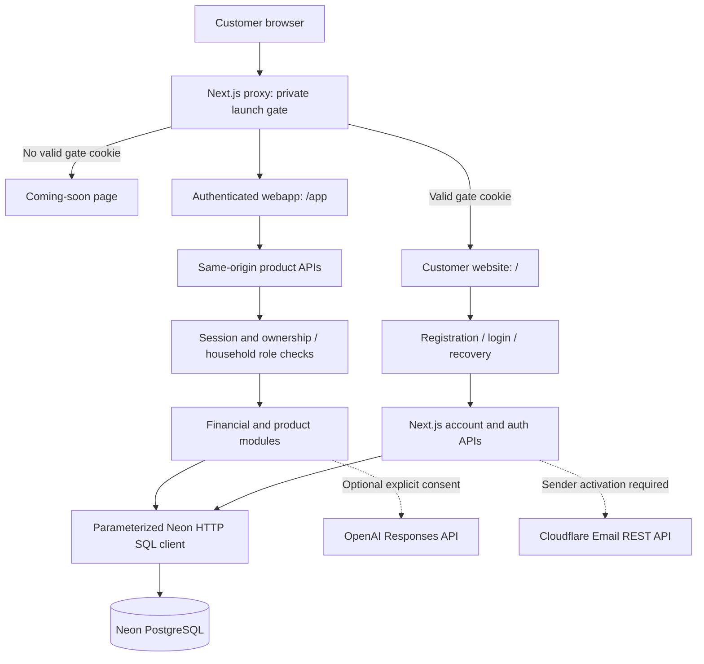
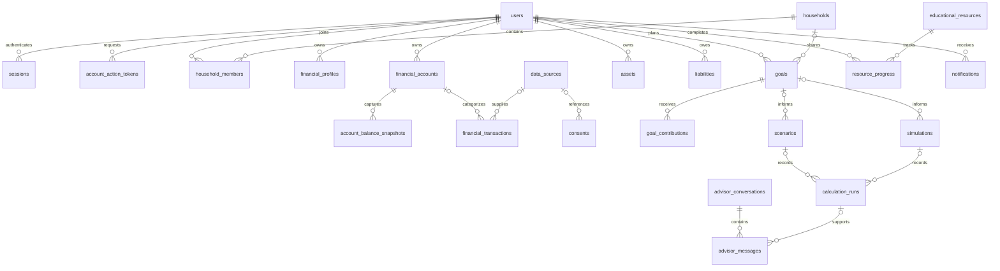

# Norte360 Technical Architecture

Engineering handoff | 6 September 2026 | Private development

## 1. Executive Summary

Norte360 is a Spanish-language personal and household financial-planning application. It is a **TypeScript modular monolith**, with a React frontend and Next.js server/API layer in one repository. PostgreSQL on Neon stores accounts and product data. Vercel is the existing application deployment platform; Cloudflare is involved in the custom-domain setup and is the intended transactional-email provider.

The customer website explains the product and links to registration/login. It does not read personal financial data. The webapp requires a personal account session. During development, a separate shared launch gate protects both the customer website and webapp.

This document describes the local working tree, not a claim that every capability is deployed, fully tested, or ready for public launch. Production remains the earlier protected build. No production deployment or infrastructure change was performed for this website/documentation task.

## 2. System Design



The diagram is logical. Account-session checks also occur when rendering `/app`. Authentication endpoints have their own validation and rate limits rather than going through the product request wrapper. External services are called on the server, not directly by the browser.

### Architectural Boundaries

| Layer | Responsibility | Principal source files |
| --- | --- | --- |
| Launch access | Protect page and API access before launch | `proxy.ts`, `src/lib/site-gate-token.ts`, `app/api/site-gate/login/route.ts` |
| Customer website | Product narrative, sample previews, FAQ, account-entry links | `app/page.tsx`, `app/marketing.module.css`, `src/components/product-explorer.tsx` |
| Identity | Registration, password hashing, sessions, rate limits, account lifecycle | `src/lib/auth.ts`, `auth-db.ts`, `account-lifecycle.ts` |
| Application UI | User inputs, saved records, product views, client request state | `src/components/norte-app.tsx` and specialized panels |
| API boundary | Account authorization, request parsing, validation, consistent errors | `app/api/**/route.ts`, `src/lib/product-api.ts`, `api-inputs.ts` |
| Domain calculations | Financial snapshot, repayment comparisons, decision estimates | `financial-engine.ts`, `portfolio-engine.ts`, `decision-engine.ts` |
| Persistence | User-scoped queries, aggregates, transactional operations | `product-db.ts`, `ledger-db.ts`, `banking-db.ts`, `planning-db.ts`, `db.ts` |
| External adapters | Optional email and AI provider calls | `email.ts`, `advisor-ai.ts` |

These are code-level module boundaries, not separate deployed microservices. Several older modules still construct their own Neon client; `db.ts` is used by newer workflows. There is no ORM, GraphQL service, queue, or independently deployed backend service in this codebase.

## 3. Languages, Frameworks and Libraries

Versions below are resolved from `package-lock.json`, not recommendations to upgrade.

| Technology | Resolved version | Use |
| --- | --- | --- |
| TypeScript | 5.9.3 | Application, server handlers, domain logic and types |
| Next.js | 16.3.4 | App Router, server rendering, routing, API handlers, proxy, builds |
| React / React DOM | 19.2.8 / 19.2.8 | UI composition and browser interactivity |
| `@neondatabase/serverless` | 1.1.0 | PostgreSQL queries over HTTP; transactions |
| `bcryptjs` | 3.0.3 | Password hashing and comparison |
| `papaparse` | 5.7.0 | Structured CSV import parsing |
| `lucide-react` | 1.41.0 | UI icons |
| Vitest | 5.0.0 | Unit-test runner |
| `@types/node` | 25.9.5 | Node API types; this does not establish the deployed Node runtime version |
| `@types/react` / `@types/react-dom` | 19.2.18 / 19.2.7 | React type definitions |
| `@types/papaparse` | 5.5.2 | CSV parser type definitions |
| `@types/bcryptjs` | 2.4.6 | Existing development type dependency |

Other technologies: SQL/PostgreSQL DDL; CSS and CSS Modules; semantic HTML/TSX; JSON request/response payloads; JavaScript `.mjs` verification scripts; Node `crypto` and Web Crypto APIs.

TypeScript is strict, targets ES2022, disallows plain JavaScript in the TypeScript project, uses bundler module resolution and the React JSX transform. The `@/*` alias resolves to `src/*`. Turbopack is the build tool selected by the installed Next.js commands. `next.config.ts` sets the project root explicitly.

There is no Tailwind, Redux, Prisma, Drizzle, Supabase, Firebase, NextAuth/Auth.js, payment SDK, or OpenAI SDK dependency. The optional OpenAI adapter uses server-side `fetch` directly. Node runtime pinning should be formalized before reproducible releases; `package.json` has no `engines` declaration.

## 4. Frontend and Customer Journey

| Route | Function | Protection |
| --- | --- | --- |
| `/coming-soon` | Shared private-access form | Public entry point |
| `/` | Customer-facing product website | Launch gate; no account session needed |
| `/create-account` | Registration form | Launch gate |
| `/login` | Personal account login | Launch gate |
| `/account-action` | Verification/reset request or token consumption | Launch gate; reset does not require existing account session |
| `/app` | Personal financial application | Launch gate plus personal session |
| `/robots.txt` | Disallow crawling | Public; not an authorization control |

The new marketing page is primarily a server component with an isolated client component for four product-preview tabs. FAQ disclosures and the compact mobile menu use native `details`/`summary`. Tab selection supports arrows, Home and End, with ARIA tab relationships. Sample amounts are labeled illustrative; they never come from an account or database.

Marketing styles live in a CSS Module, avoiding changes to existing app styles. The application still uses `app/globals.css`. Responsive layouts use explicit breakpoints and constrained grid columns. Icons use Lucide. The hero reuses an existing external Unsplash asset; this introduces an external image request. A self-hosted, licensed asset is a release consideration.

Product components include `banking-panel`, `ledger-editor`, `goal-planner`, `decision-lab`, `learning-panel`, `history-panel` and `account-settings`. Browser state uses React state/hooks and same-origin fetch calls. There is no offline-first synchronization or global state-management library.

## 5. Identity and Access Controls

### Two Separate Access Layers

1. The private launch gate verifies a shared credential and issues a signed gate cookie. This grants access to the customer website and account-entry pages, not to another person's financial records.
2. Registration/login creates a personal session. Product APIs derive the user from that session and use ownership filters and household permissions for data access.

The gate uses HMAC-SHA256 over an expiry value, with a seven-day lifetime. The production cookie is `__Host-norte360_gate`; development uses `norte360_gate`. Gate credentials are configured on the server. Missing configuration fails closed. The shared gate is temporary launch protection, not a replacement for individual authentication or enterprise SSO.

Private page requests without the gate redirect to `/coming-soon`. Private API requests return 401 JSON. Static framework assets and `/images/` or `/assets/` paths are allowed, so secrets or personal data must never be placed in those directories. Allowed private responses carry no-index/private-cache headers. Root metadata also disables indexing.

### Personal Accounts

- Passwords use bcrypt with cost 12. The current validation accepts 15-128 characters. Review bcrypt's 72-byte input behavior and Unicode handling before launch; character length is not equivalent to byte length.
- Session tokens contain 32 random bytes; only SHA256 token hashes are stored in the database.
- Session lifetime is 30 days. Cookies are HTTP-only, SameSite=Lax, path `/`, and Secure in production.
- Password changes and successful resets revoke sessions. Logout clears the browser cookie and attempts server-side revocation.
- Verification/reset tokens are random, SHA256-hashed at rest, expire after 30 minutes, and are consumed through conditional SQL operations.
- Recovery links carry the token in the URL fragment, and the recovery page removes the fragment after reading it. The gate form preserves the fragment when continuing to the recovery page.
- Account deletion requires password confirmation and refuses deletion while another member remains in a household the user owns. Account export omits password/session/action-token records.

### Request Protections and Limits

The common product wrapper authenticates the account, rejects a conflicting Origin on mutations, validates a JSON object body and maps validation errors to 400, duplicate constraints to 409, and unexpected failures to a generic 500. Missing Origin is currently accepted; this is not a dedicated CSRF-token scheme.

The normal body limit is 16,000 JavaScript string characters; the CSV route overrides it to 524,288. Despite the parameter name `maxBytes`, the implementation measures string length after reading the body. Streaming byte limits and request Content-Type enforcement are hardening work, not current guarantees.

Rate limits are persisted in `auth_rate_limits`. Auth login uses 8 attempts per 15-minute action/IP/email bucket; other auth actions use 5 in that window. Gate, lifecycle and AI actions also have endpoint-level rate limiting. IP and user-agent fingerprints are hashed. Trusted-proxy handling and a full distributed abuse review still need validation.

Authorization is enforced in application queries. SQL constraints enforce relationships and valid values. The checked-in schema does not define PostgreSQL row-level security policies; do not describe this as database-enforced tenant isolation. Security-header/CSP configuration, MFA, OAuth login, security monitoring and an external penetration test are not established by this implementation.

## 6. Database Design

**Database:** PostgreSQL on Neon. **Access:** parameterized SQL through the Neon HTTP driver. **Schema:** 25 tables across auth, product and workflow SQL files. The deployed PostgreSQL version, region, backup retention and service plan are not confirmed by this code snapshot.

Money is represented using integer cents in BIGINT database columns and validated safe integers in application code. Rates use basis points in calculation contracts. CRC is the primary workflow currency; CSV import currently accepts CRC only. Monthly actuals use the Costa Rica time zone. JSON/JSONB fields retain planning assumptions, provider metadata and calculation inputs/results alongside relational ownership and reference columns.

| Domain | Tables | Purpose |
| --- | --- | --- |
| Identity | `users`, `sessions` | Identity, password hash, verification/deletion timestamps; hashed sessions and revocation |
| Abuse/audit | `auth_rate_limits`, `audit_events` | Request buckets and authentication/audit event records |
| Account actions | `account_action_tokens` | Expiring verification/reset token hashes |
| Household | `households`, `household_members` | Household ownership, membership status, roles |
| Financial baseline | `financial_profiles` | Income, expenses, currency/country, emergency target and planning JSON |
| Provenance | `data_sources`, `consents` | Manual/import source identity and sharing/import consent |
| Accounts | `financial_accounts`, `account_balance_snapshots` | Account metadata and captured balance history |
| Transactions | `financial_transactions` | Dated signed movements, description, category and source references |
| Position | `assets`, `liabilities` | Individual assets and debts, values, interest and repayment inputs |
| Goals | `goals`, `goal_contributions` | Targets, progress, monthly allocations and individual contributions |
| Decisions | `scenarios`, `simulations`, `calculation_runs` | Saved assumptions, comparisons, outputs and calculation provenance |
| Advisor | `advisor_conversations`, `advisor_messages` | User conversations and messages with optional calculation links |
| Learning | `educational_resources`, `resource_progress` | Published content and per-user completion |
| Notices | `notifications` | Per-user notices, timestamps and read state |

### Relationships



This is a selected relationship diagram, not every foreign key. Most product tables also reference `users` directly; several support optional household links. An individual financial profile has a partial unique index for `household_id IS NULL`. The full SQL files are the source of truth for every column, constraint and index.

### Schema Files and Change Order

1. `sql/auth-schema.sql`: identity and auth tables.
2. `sql/product-schema.sql`: product tables and ownership/query indexes.
3. `sql/product-runtime-migration.sql`: financial-profile planning JSON compatibility change.
4. `sql/complete-workflows.sql`: account-action tokens, resource progress, goal contributions, goal allocations, import/pagination indexes, removal of the one-goal-per-type index.
5. `sql/resources.sql`: curated educational content seed.

The additional workflow migrations were applied during prior implementation work. This website task did not run migrations. There is no checked-in versioned migration ledger or automated rollback system. SQL `IF NOT EXISTS` helps with reruns but does not prove all schema changes are reversible or drift-free.

### Data Semantics

- Confirmed account balances and transaction totals are separate. Saving a transaction does not update a confirmed balance automatically.
- Account inclusion in net worth is opt-in to reduce duplicate counting with manually entered assets. Credit/debt accounts do not replace the individual liability register used for interest calculations.
- CSV parsing accepts up to 500 rows and the configured request limit. Expected columns are `date,description,amount,currency,category`; amounts use decimal dots.
- Import IDs and row IDs support deduplication. Sources, consent and imported records are stored transactionally. Revocation can optionally erase imported rows.
- Asset/debt and goal removal uses soft deletion. Account archiving, notice deletion, history deletion and full account erasure have different lifecycle semantics.
- Contributions are recorded and goal progress incremented atomically. Contribution reversal/history UI is not yet complete.
- Household sharing requires accepted membership. Roles include owner, admin, contributor and viewer, with operation-specific checks.
- Pagination uses cursor pairs: date/ID for transactions and timestamp/ID for selected histories, typically 50 records per page.

## 7. API Inventory

Paths are relative to the application's origin. These are internal JSON HTTP endpoints, not a versioned public developer API. Mutations generally take a JSON object. Full payload validation lives beside the route/domain implementation. There is no generated OpenAPI specification yet.

| Endpoint | Methods | Purpose |
| --- | --- | --- |
| `/api/site-gate/login` | POST | Check shared launch credential; issue gate cookie |
| `/api/auth/register` | POST | Create user and session |
| `/api/auth/login` | POST | Verify password and issue session |
| `/api/auth/logout` | POST | Revoke/clear current session |
| `/api/auth/session` | GET | Current session/user lookup |
| `/api/app-data` | GET | Aggregate authenticated workspace payload |
| `/api/financial-profile` | GET, PUT | Read/save financial inputs and profile |
| `/api/ledger` | GET, PUT, DELETE | Read/create/edit/soft-delete assets and liabilities |
| `/api/banking` | GET, PUT, DELETE | Accounts, balances and account archival |
| `/api/transactions` | GET, PUT, DELETE | Cursor history, transaction create/edit/delete |
| `/api/imports` | POST, DELETE | CSV import; revoke consent and optionally erase rows |
| `/api/planning` | GET, PUT, POST, DELETE | List/save goals, add contributions, soft-delete goals |
| `/api/goals` | POST | Retained personal-goal create/update endpoint |
| `/api/scenarios` | POST | Calculate and save repayment routes |
| `/api/simulations/home-purchase` | POST | Mortgage estimate and persistence |
| `/api/simulations` | POST | Other supported decision estimates and persistence |
| `/api/history` | GET | Paginated scenarios, simulations, notifications or advisor messages |
| `/api/records/[kind]/[id]` | DELETE | Allowlisted owned goal/scenario/simulation/notification removal |
| `/api/family` | POST, PATCH, DELETE | Create/read household; rename, invite, accept, remove, update role; archive household |
| `/api/advisor` | POST, DELETE | Rules/optional AI exchange; clear conversation |
| `/api/notifications/read` | POST | Mark notifications read |
| `/api/resources` | GET, POST, PUT, DELETE | Read content, save completion, admin create/edit/unpublish |
| `/api/account` | GET, POST, DELETE | Account status/export; verification request/password change; erasure |
| `/api/account-action` | POST | Request recovery or consume verification/reset token |

`/api/account?export=true` exports personal data. Resource publishing requires both verified email and an address in `RESOURCE_ADMIN_EMAILS`. `/api/account-action` is intentionally usable without an account session but remains behind the launch gate and endpoint checks. Personal product APIs do not become authorized just because the gate cookie is valid.

## 8. Product and Calculation Logic

| Module | Behavior | Limitations |
| --- | --- | --- |
| `financial-engine.ts` | Money normalization, payment/payoff math, cash flow, net worth, internal Norte Score | Score is heuristic, not a validated credit score |
| `portfolio-engine.ts` | Per-debt monthly repayment simulation; avalanche and snowball; redistributes freed payment budget | No global optimization, uncertain-rate model or Monte Carlo engine; 1,200-month cap |
| `decision-engine.ts` | Car purchase, consolidation, investment/debt comparison, net salary changes and windfall allocation | Simplified inputs; no statutory payroll/aguinaldo calculation |
| `product-db.ts` | Connects profile, routes, simulations, family, advisor and notice operations to storage | Large module; legacy helpers and route prevalidation still need cleanup |
| `planning-db.ts` | Multiple/shared goals, allocations, contributions, ownership/role checks | Cross-scope allocation overlap remains a known gap |
| `banking-db.ts` | Account snapshots, transactions, monthly actuals, imports and consents | No bank sync; household totals do not yet include all optional account balances |

Route variants map to snowball, avalanche, reduced extra-payment and a simple income-stress assumption. Do not market them as proven fastest/safest outcomes. Mortgage estimates exclude insurance and closing expenses. No trade, transfer, lending approval or payment execution takes place.

## 9. External Services and Configuration

Only variable names are documented. Never put real secrets in this document, browser bundles, Git, logs or shared screenshots.

| Variable | Use | Activation status |
| --- | --- | --- |
| `DATABASE_URL` | Neon PostgreSQL connection string | Configured in the local environment used for prior database tests |
| `SITE_GATE_USER` | Shared launch username | Existing private-access configuration |
| `SITE_GATE_PASSWORD_HASH` or `SITE_GATE_PASSWORD_HASH_B64` | Gate password hash; base64 variant preferred when provided | Existing configuration; base64 is encoding, not encryption |
| `SITE_GATE_SECRET` | Gate-cookie HMAC secret | Required to keep gate verification working |
| `APP_BASE_URL` | Canonical account-action link origin | Needed for email activation |
| `CLOUDFLARE_ACCOUNT_ID` | Sender account identifier | Needed for email activation |
| `CLOUDFLARE_EMAIL_TOKEN` | Server-side email authorization | Not activated in the checked local setup |
| `EMAIL_FROM` | Verified sending address | Not activated in the checked local setup |
| `OPENAI_API_KEY` | Server-side AI authorization | Not activated in the checked local setup |
| `OPENAI_MODEL` | Explicit model identifier; no invented default | Not activated in the checked local setup |
| `RESOURCE_ADMIN_EMAILS` | Comma-separated verified-account allowlist | Must be configured for resource administration |

Cloudflare Email uses its account-scoped `/email/sending/send` REST endpoint with a 15-second timeout. Failed delivery removes the newly created account-action token. Sender domain setup and deliverability are not demonstrated by the adapter existing in code.

The optional advisor uses OpenAI `/v1/responses`, `store:false`, a 1,200-token output limit, a 30-second timeout and explicit per-request consent. It sends a question, financial summary and recent conversation context. Free text can contain personal information even when structured names/emails are omitted. It has no tools for moving money or changing records. Provider retention terms must be reviewed separately; `store:false` is not a blanket zero-retention guarantee.

The configured hostname is `tunorte360.com`, with `www.tunorte360.com` also used. The existing deployment platform is Vercel. DNS/Cloudflare settings, TLS state, Vercel environment values and platform plan were not re-audited during this task. No Cloudflare Worker, D1 database or Sites hosting migration was introduced.

## 10. Repository and Operating Model

```text
app/                 Next.js pages, layouts, CSS and API route handlers
src/components/      Marketing preview, auth forms and finance panels
src/lib/             Auth, validation, domain logic, persistence, adapters, unit tests
sql/                 PostgreSQL schemas, migrations and seed data
scripts/             Disposable-account and read-only HTTP verification scripts
docs/                Engineering documentation
output/pdf/          Requested functional-map artifact
proxy.ts             Private launch boundary
package-lock.json    Reproducible dependency resolution
next.config.ts       Framework configuration
tsconfig.json        TypeScript compiler settings
```

| Command | Purpose |
| --- | --- |
| `npm ci` | Install the locked dependency set |
| `npm run dev -- --port 3012` | Local development preview; use another port if occupied |
| `npm run build` | Next.js production compile, types, page generation |
| `npm start` | Run the built application locally |
| `npm test` | Vitest unit suite |
| `node scripts/verify-product.mjs` | Existing disposable-account database/API suite; review environment and cleanup before running |
| `node scripts/verify-marketing.mjs` | Read-only localhost:3012 marketing and access-boundary checks |

The existing `npm run lint` invokes `next lint`; a working standalone lint configuration has not been verified for this framework version. No CI pipeline, deployment rollback rehearsal, migration runner, backup restore drill or observability service is established by these commands. Do not run database integration tests against production without a deliberate isolated-test policy.

### Deployment Sequence to Preserve Privacy

1. Review and commit a scoped, tested release; keep unrelated unfinished changes out of that release.
2. Use an isolated database branch/environment to test migrations and lifecycle flows.
3. Verify gate secrets and account/database configuration in the target Vercel environment.
4. Deploy a protected preview and check pages, APIs, cookies, redirects and error states.
5. Promote only the approved private build; confirm the custom domain still shows the coming-soon gate to an anonymous visitor.
6. Keep the gate and no-index configuration until the owner explicitly authorizes public exposure. A new marketing design does not itself authorize removal of the gate.

## 11. Verification and Known Gaps

For this website pass, the production build succeeded, all 12 existing unit tests passed, and 35 read-only HTTP checks passed for marketing content, section targets, account links and the launch/account-session boundaries. The external hero image returned HTTP 200 with an image content type. Browser visual/interaction regression was not run in this pass.

The earlier database regression suite passed 73 HTTP checks with disposable-account cleanup. That is evidence for the tested core flows, not exhaustive testing of every new workflow. Dedicated banking, lifecycle, resource administration, shared planning and optional provider end-to-end suites remain necessary.

Priority engineering work before public release:

- Resolve cross-scope personal/shared goal allocation overlap and household account-balance aggregation.
- Validate import revocation/reimport behavior, concurrency and contribution reversals.
- Finish household role-management UI and email invitations to nonregistered people.
- Activate/test sender verification, password recovery, provider failures and optional AI consent flows.
- Align route names and remove conflicting legacy aggregated-debt prevalidation.
- Validate bcrypt byte handling, CSRF/origin policy, body limits, security headers and distributed rate limits.
- Add versioned migrations, release CI, operational monitoring, structured redacted logs, backup/restore checks and load testing.
- Complete accessibility and desktop/mobile browser tests, including all marketing tabs and account journeys.
- Independently review financial models and approve customer-facing terms/privacy content and pricing before selling publicly.

The application is database-backed, but a database connection alone does not make the entire product complete. This distinction should remain explicit in release decisions and customer communications.

## 12. Source of Truth

This handoff is based on `package.json`, `package-lock.json`, `tsconfig.json`, `next.config.ts`, `proxy.ts`, the route handlers, components, domain/persistence modules, SQL files and verification scripts in this repository. The SQL files provide exact table/column definitions; the API handlers provide exact accepted payloads. Earlier `FEATURE_AUDIT.md` gap statements predate some newer local functionality. No credentials or actual customer records are included here.
